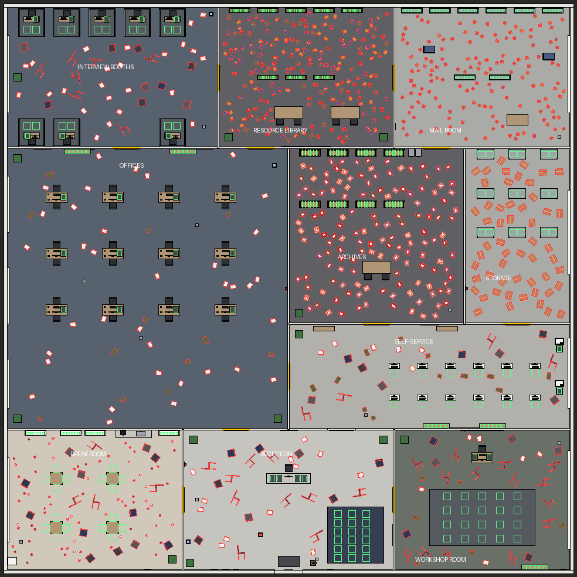

# Northfield Employment Agency — jeu de rangement calme pour Roblox

Jeu solo (PC et mobile, **en anglais**), ton sérieux et ambiance de bureau réaliste :
le joueur range une agence pour l'emploi fictive. Dossiers, piles de papiers, chaises,
cartons, tasses et plantes traînent partout. Il faut les ramasser et les remettre à leur place. Un compteur indique
combien d'objets il reste, et un message s'affiche quand l'agence est en ordre.

L'agence entière (bâtiment, mobilier, lumières, objets) est **construite par les
scripts au lancement du jeu**. Il n'y a rien à poser à la main dans Studio.

## Méthode 1 : ouvrir le fichier prêt à jouer (le plus simple)

1. Téléchargez **`AgencePourLEmploi.rbxl`**.
2. Double-cliquez dessus, ou dans Roblox Studio : **File > Open from File…**
3. Cliquez sur **Play**.

> En mode édition, l'agence n'est pas visible : elle est construite seulement
> quand le jeu tourne. C'est normal.

## Méthode 2 : créer les scripts à la main

Partez d'un nouveau jeu avec le modèle **Baseplate**, créez les 4 scripts
(clic droit sur le dossier > **Insert Object**), renommez-les **exactement**,
effacez le texte par défaut et collez le contenu du fichier.

| Où le mettre dans Studio             | Type         | Nom             | Fichier                                            |
|--------------------------------------|--------------|-----------------|----------------------------------------------------|
| ReplicatedStorage                    | ModuleScript | `TidyConfig`    | `src/ReplicatedStorage/TidyConfig.lua`             |
| ServerScriptService                  | ModuleScript | `AgencyBuilder` | `src/ServerScriptService/AgencyBuilder.lua`        |
| ServerScriptService                  | Script       | `TidyManager`   | `src/ServerScriptService/TidyManager.server.lua`   |
| StarterPlayer > StarterPlayerScripts | LocalScript  | `TidyUI`        | `src/StarterPlayerScripts/TidyUI.client.lua`       |

(Les terminaisons `.server` et `.client` servent seulement à fabriquer le fichier
`.rbxl` : dans Studio, les noms sont bien `TidyManager` et `TidyUI`.)

## Comment on joue

Un jeu de rangement **calme et satisfaisant** : chaque objet a sa place, on range à son rythme
dans une grande agence de 7 pièces et on la voit devenir propre et organisée.

- **Vue à la première personne** avec un **viseur** au centre de l'écran.
- **Ramasser :** visez un objet (« Click to pick up ») et cliquez. Sur mobile, appuyez sur l'objet.
- **Ranger :** visez le meuble où il se range (« Click to put away ») et cliquez. Les places libres
  brillent en vert, les meubles concernés sont entourés.
- **Plusieurs objets en main :** 3 au départ. **Molette** (ou **E**, ou boutons < >) pour changer d'objet,
  **Q** (A sur AZERTY) ou bouton « Drop » pour lâcher.
- **Y :** libérer la souris (pour cliquer sur les boutons). Elle se libère aussi quand une fenêtre est ouverte.
- **Points :** chaque objet rangé rapporte des points, et chaque pièce entièrement rangée donne **100 points bonus**.
- **Pièces à débloquer :** cliquez sur une porte vitrée verrouillée pour l'ouvrir avec vos points.
- **Améliorations (touche G) :** sac plus grand, chaussures de course, aimant, loupe.
- **Outils (touches 1, 2, 3) :**
  - **Main** : ramasser et ranger ;
  - **Aimant** : un clic attire dans le sac les objets proches ;
  - **Loupe** : un rayon doré montre l'objet le plus proche, ou la place où ranger.
- En bas de l'écran, **« You are in: … »** affiche la pièce et sa progression.
- En haut à droite : **« Items left to put away: … »** et le détail par catégorie.
- **Fin :** message « The agency is in order. », puis **Play again**. Les pièces ouvertes,
  les points et les améliorations sont conservés.

| Pièce (nom dans le jeu)        | Prix pour ouvrir | Objets à ranger                           |
|--------------------------------|------------------|-------------------------------------------|
| Accueil (Reception)            | ouverte          | 12 piles de papiers, 18 chaises           |
| Couloir (Hallway)              | ouvert           | 12 plantes                                |
| Bureaux (Offices)              | 200 points       | 36 piles de papiers, 12 plantes           |
| Salle de pause (Break Room)    | 400 points       | 36 tasses, 16 chaises                     |
| Archives (Archives)            | 600 points       | 72 dossiers                               |
| Réserve (Storage)              | 800 points       | 36 cartons                                |
| Salle de formation (Training Room) | 1000 points  | 20 chaises, 6 piles de papiers, 6 plantes |

Total : **282 objets** par partie.

## Plan (vue de dessus)



Exemple de partie. En rouge : les objets qui traînent (placés au hasard). En vert : les places de rangement.

## Réglages simples (script `TidyConfig`)

- `AgencyName` : nom de l'agence affiché sur les panneaux et l'interface.
- `ItemTypes` : noms affichés et consignes pour chaque type d'objet.
- `Rooms` : les pièces, leur prix d'ouverture et le nombre d'objets de chaque type.
- `RoomBonus` : points bonus pour une pièce entièrement rangée.
- `ReachDistance` : distance à laquelle on peut ramasser / ranger.
- `BaseCapacity`, `BaseWalkSpeed` : sac et vitesse de départ.
- `Upgrades` : prix et niveaux des améliorations.

Les objets sont placés au hasard à chaque partie, en évitant les meubles.

## Refabriquer le fichier `.rbxl` (pour le développeur)

```
rojo build default.project.json -o AgencePourLEmploi.rbxl
```
