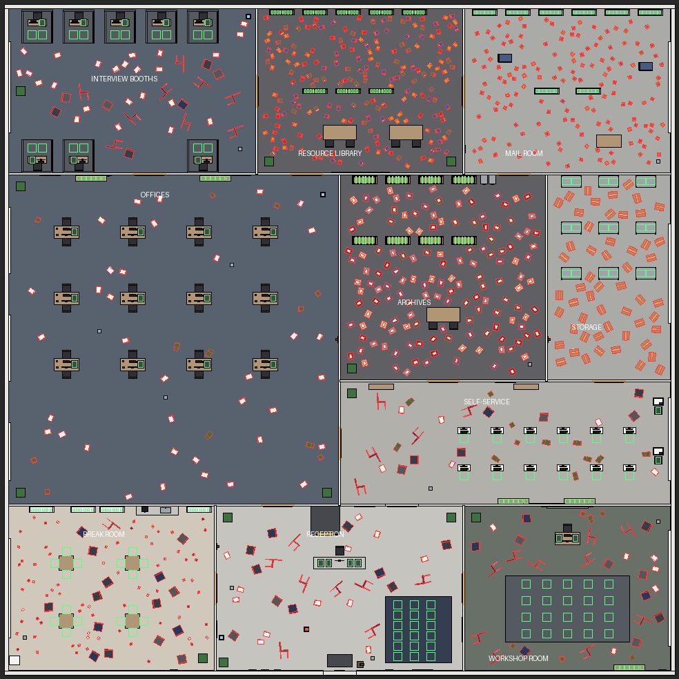
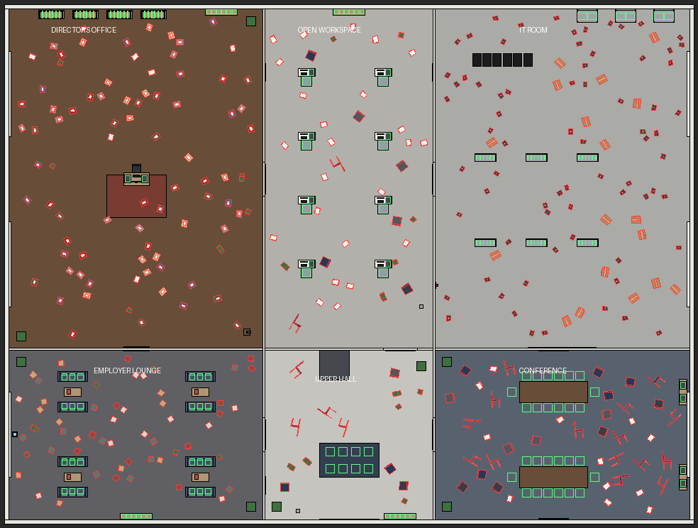

# Tidy Up! Workplace Chaos — jeu de rangement pour Roblox

Jeu de rangement **calme et satisfaisant**, vue à la première personne, PC et mobile, textes **en anglais**.
On range des lieux de travail en désordre : ramasser les objets par terre, suivre les panneaux,
les poser sur la bonne étagère. Seul ou jusqu'à 4 joueurs.

Tout le monde (hall d'accueil, niveaux, mobilier, objets, lumières) est **construit par les scripts
au lancement du jeu**. Il n'y a rien à poser à la main dans Studio.

## Nouveautés de la version 7

- **Hall d'accueil intérieur** : murs rosés et soubassement en bois, verrière violette en voûte,
  fenêtres en arc, colonnes, palmiers, fontaine, **6 plateformes vertes** (« Empty / Waiting for players / PLAY »),
  borne « Join a friend ».
- **Mur des classements à l'entrée** : 4 grands panneaux surmontés d'une gemme lumineuse,
  **TOP WINS** et **temps le plus rapide** pour chaque niveau (records sauvegardés).
- **Boutique stylée** : enseigne SHOP verte, assistant sur sa plateforme, **6 affiches en arc**
  des articles Robux (cliquer = acheter directement), nouvelle fenêtre boutique en cartes
  (GAME PASSES / POINTS & BOOSTS, rubans NEW!, BEST!, DEAL!).
- **3 niveaux** :
  - **Employment Agency** : l'agence pour l'emploi, 16 pièces sur 2 étages, 1 122 objets ;
  - **Distribution Warehouse** : immense entrepôt de 9 sections, 2 320 objets (débloqué après 1 victoire) ;
  - **Corporate Headquarters** : siège social de luxe, 9 pièces, 1 714 objets (débloqué après 3 victoires).
- **Progression cumulable** : les pièces s'ouvrent toutes seules selon les points **gagnés** sur le
  niveau (on ne dépense rien pour ouvrir une pièce, rien n'est perdu). La journée en cours est
  **sauvegardée** : en revenant, les objets déjà rangés sont toujours à leur place.
- **Interface style "cartes"** : chronomètre, compteurs, offre limitée **DEAL**, boutons
  Upgrades [G], Shop [F], Quests [J], Settings [R], carte de l'objet en main (rayon + nom précis),
  barre d'outils à 4 cases avec cadenas, **6 cartes de tutoriel** à l'entrée d'un niveau.
- **Objets très détaillés** (ours en peluche, voitures, bidons de lessive, conserves, boîtes à chaussures,
  trophées, cadres, classeurs...) et **pile d'objets portés visible** dans les mains.
- **Boutique Robux** : 6 pass et 5 produits (voir plus bas).
- **Quêtes du jour**, victoires, rangs jusqu'à **CEO**, bonus quotidien.
- Graphismes **lumineux et chaleureux** : plafonds en lattes de bois, bandeaux lumineux, puits de lumière,
  lustres, suspensions, panneaux de rayon suspendus.

## Ouvrir le jeu

1. Téléchargez **`AgencePourLEmploi.rbxl`**.
2. Double-cliquez dessus, ou dans Roblox Studio : **File > Open from File…**
3. Cliquez sur **Play**. Vous apparaissez dans le hall : marchez sur une plateforme lumineuse,
   choisissez un niveau et le nombre de joueurs, puis **START**.

> En mode édition, le monde n'est pas visible : il est construit seulement quand le jeu tourne. C'est normal.

## Les 4 scripts

| Où le mettre dans Studio             | Type         | Nom             | Fichier                                            |
|--------------------------------------|--------------|-----------------|----------------------------------------------------|
| ReplicatedStorage                    | ModuleScript | `TidyConfig`    | `src/ReplicatedStorage/TidyConfig.lua`             |
| ServerScriptService                  | ModuleScript | `AgencyBuilder` | `src/ServerScriptService/AgencyBuilder.lua`        |
| ServerScriptService                  | Script       | `TidyManager`   | `src/ServerScriptService/TidyManager.server.lua`   |
| StarterPlayer > StarterPlayerScripts | LocalScript  | `TidyUI`        | `src/StarterPlayerScripts/TidyUI.client.lua`       |

(Les terminaisons `.server` et `.client` servent seulement à fabriquer le fichier `.rbxl` :
dans Studio, les noms sont bien `TidyManager` et `TidyUI`.)

## Comment on joue

### Hall d'accueil
- Marchez sur une des **6 plateformes lumineuses** : le premier joueur devient chef du groupe et choisit
  le **niveau** et le **nombre de joueurs (1 à 4)**. Les autres montent sur la même plateforme.
- Le départ se fait quand le groupe est complet (compte à rebours de 5 s) ou quand le chef appuie sur **START**.
- Dans le jeu publié, le groupe part dans **son propre serveur**. Un **code** s'affiche en haut à gauche :
  un ami peut le taper à la borne **JOIN A FRIEND** pour vous rejoindre.
- Le comptoir **SHOP** (et les vitrines) ouvre la boutique.

### Dans un niveau
- **Viseur** au centre : visez un objet et cliquez pour le mettre dans le panier ; visez l'étagère indiquée
  par les **panneaux suspendus** et cliquez pour le ranger. Sur mobile, touchez l'objet ou le meuble.
- Les objets portés s'**empilent** dans vos mains. **Molette** (ou **E**) : changer d'objet. **Q** (A en AZERTY) : lâcher.
- Outils : **1** main, **2** aimant, **3** loupe (rayon qui montre où aller), **4** rangement rapide
  (range d'un clic tous les objets du panier qui vont sur ce meuble).
- **Y** : libérer la souris. **M** : couper la musique. **G / F / J / R** : améliorations, boutique, quêtes, paramètres.
- Livres, colis et classeurs vont sur le meuble de **la même couleur**.
- Quand tout est rangé : **victoire** (+1 win, +1 000 points), puis **Play again** ou **Back to lobby**.

### Progression (sauvegardée)
- Points, améliorations, victoires, points gagnés par niveau, quêtes, réglages et **journée en cours**.
- Les pièces / sections s'ouvrent selon les **points gagnés sur ce niveau** (affiché sur les portes et clôtures).
- **Rangs** selon le total d'objets rangés : Intern → Office Assistant → Filing Clerk → Stock Keeper →
  Records Officer → Team Leader → Office Manager → Operations Director → CEO.
- **Bonus quotidien** : 100 points par jour de suite (jusqu'à 700 au 7e jour, x2 pour les VIP).
- **3 quêtes par jour** (ranger N objets, N cartons, finir N pièces, gagner N points), récompenses automatiques.

## Boutique Robux : à faire une fois le jeu publié

Les articles sont déjà dans le jeu. Il faut juste les créer sur Roblox et coller leur numéro :

1. Publiez le jeu (**File > Publish to Roblox**).
2. Sur le **Creator Hub** : votre expérience > **Monetization > Passes** > **Create a Pass**.
   Créez ces 6 pass (prix conseillés) :
   - **+5 Carry**, 49 R$ : 5 objets de plus dans le panier.
   - **+15 Carry**, 129 R$ : 15 objets de plus.
   - **Max Speed**, 79 R$ : vitesse maximale tout de suite.
   - **Infinite Magnet**, 99 R$ : aimant débloqué, portée de 60 studs.
   - **x2 Points**, 149 R$ : double tous les points.
   - **VIP**, 199 R$ : étiquette VIP dorée, +25 % de points, bonus quotidien x2.
3. **Monetization > Developer Products** > **Create** : créez ces 5 produits (prix conseillés) :
   - **Starter Deal**, 19 R$ : 3 000 points + 3 places de panier pour toujours. Achat unique, affiché 5 min dans le badge DEAL.
   - **1,000 Points**, 25 R$.
   - **6,000 Points**, 99 R$.
   - **30,000 Points**, 399 R$.
   - **Tidy Helper**, 49 R$ : range 50 objets tout seul.
4. Copiez le numéro (ID) de chaque article dans le script **`TidyConfig`** : `GamePassId = 0`
   devient `GamePassId = 123456789` (même chose avec `ProductId` pour les produits).

Tant qu'un numéro vaut 0, l'article est « Coming soon » dans le jeu publié. **Dans Studio, il est offert pour la
session**, ce qui permet de tester tous les effets gratuitement.

Pour que le jeu rapporte, il faut surtout du monde : une belle icône et des miniatures, un titre clair,
mettre à jour régulièrement (nouvel événement, nouveau niveau) et éventuellement les publicités Roblox.

## Sauvegarde dans Studio

Les sauvegardes utilisent les DataStores de Roblox. Pour les tester dans Studio : publiez le jeu, puis
**Home > Game Settings > Security > Enable Studio Access to API Services**. Sans cela, le jeu marche
normalement mais rien n'est sauvegardé entre deux tests.

## Musique d'ambiance (originale, libre de droits)

Le fichier **`assets/chill_loop.mp3`** est une musique calme **composée pour ce jeu**
(générée par `tools/compose_music.py`) : vous pouvez l'utiliser librement. Pour l'activer :
1. Sur le Creator Hub : **Development Items > Audio > Import**, choisissez `chill_loop.mp3`.
2. Copiez l'identifiant de l'audio (un nombre).
3. Dans `TidyConfig`, remplacez `TidyConfig.MusicSoundId = ""` par `TidyConfig.MusicSoundId = "rbxassetid://VOTRE_NOMBRE"`.

Le volume se règle dans **Settings [R]**.

## Réglages simples (script `TidyConfig`)

- `GameTitle`, `AgencyName` : noms affichés.
- `Maps` : les niveaux, leur description et le nombre de victoires nécessaires (`WinsRequired`).
- `Rooms` : pièces de chaque niveau, seuil d'ouverture (`Unlock`, en points gagnés) et objets.
- `ItemTypes` : noms, rayon, noms précis (`Variants`), consignes et points de chaque objet.
- `Upgrades` : prix et niveaux des améliorations.
- `GamePasses`, `Products`, `PassEffects`, `DealDuration` : boutique.
- `Ranks`, `DailyBonusPerDay`, `QuestTemplates` : rangs, bonus quotidien, quêtes.
- `BaseCapacity`, `BaseWalkSpeed`, `ReachDistance`, `RoomBonus`, `DayBonus`, `MaxPartySize`.
- `LightLevel` : intensité de l'éclairage (1 = normal, 0.8 = plus sombre, 1.2 = plus clair).

## Plan de l'agence





## Refabriquer le fichier `.rbxl` (pour le développeur)

```
rojo build default.project.json -o AgencePourLEmploi.rbxl
```
